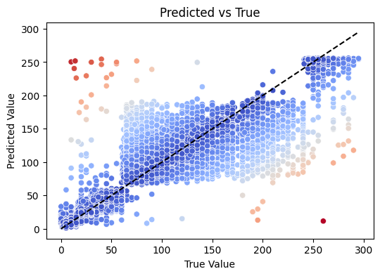
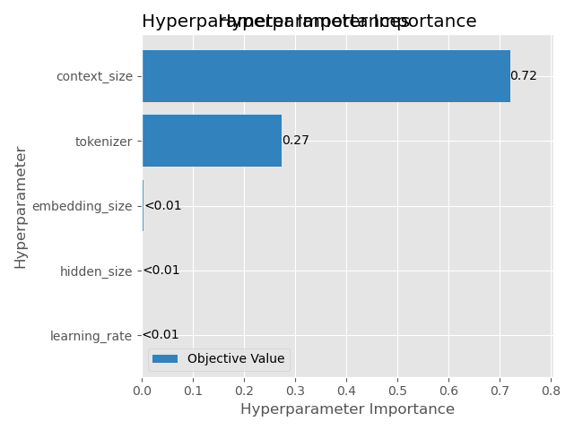

# Recipe NLP — Cooking-Time Regression & Recipe Generation

NLP project on the [Food.com](https://www.kaggle.com/datasets/shuyangli94/food-com-recipes-and-user-interactions) dataset (~230k recipes) tackling two tasks:

1. **Regression** — predict a recipe's total preparation time from its text (name, tags, ingredients, steps) and metadata.
2. **Generation** — generate step-by-step cooking instructions from a list of ingredients.

The models are served through a Streamlit app, *"Auguste Gusteau, The CookBro"*, with recipe search, cooking-time prediction and step generation.

Team project, EPITA (Natural Language Processing course, 2025). The full write-up is in [`report.pdf`](report.pdf).

<p align="center">
  
  
</p>

## Highlights

- **Text preprocessing pipeline**: lemmatization and stop-word removal (NLTK) plus a custom list of 400+ noisy words; unit typo correction and standardization (°F → °C, inches → cm); conversion of ranges and fractions (`"2-3"` → `2.5`, `"1/2"` → `0.5`); stemming; outlier filtering (recipes over 5 h).
- **Regression benchmark** across Linear Regression, Bayesian Ridge, a feed-forward NN, a GRU and a fine-tuned DistilBERT, with **TF-IDF vs Word2Vec** embeddings.
- **Hyperparameter search with Optuna**: importance, parallel-coordinate and contour plots.
- **Generation models**: n-gram baseline, FFNN, simple RNN and GRU-based RNN, compared across tokenizers (Keras, BPE, Hugging Face AutoTokenizer) and context sizes.
- **Model interpretation**: permutation feature importance, residual analysis, and embedding-space inspection for the generator.
- **Ensembling experiments**: bagging and stacking.
- **MLOps scaffolding**: MLflow tracking backed by PostgreSQL and MinIO (S3), Docker Compose, and GitLab CI pipelines per model.

## Results

### Cooking-time regression (test set)

| Model | Embedding | MAE (min) | R² | Train time |
|---|---|---|---|---|
| Linear Regression | TF-IDF | 17.32 | 0.59 | 8 s |
| Bayesian Ridge | TF-IDF | 17.34 | 0.59 | 14 s |
| **Feed-forward NN** | TF-IDF | **13.97** | 0.68 | 253 s |
| GRU | TF-IDF | 14.54 | **0.70** | 3743 s |
| DistilBERT (1 epoch) | WordPiece | 17.79 | 0.55 | 3672 s |
| Feed-forward NN | Word2Vec | 20.15 | 0.45 | 110 s |

The **feed-forward NN on TF-IDF** gives the best trade-off: the lowest MAE, and a GRU only beats it marginally on R² at about 15× the training time. TF-IDF consistently outperforms Word2Vec here because explicit keywords such as durations (`60`, `hour`) and methods (`bake`, `stove`) predict time better than semantic similarity does. The most important features are the number of ingredients and the number of steps.

### Step generation (next-token validation accuracy)

| Model | Best configuration | Val. accuracy |
|---|---|---|
| N-gram | BPE-80 tokenizer, N = 8 | 0.74 |
| Feed-forward NN | BPE-80, context 8, emb 256 / hidden 128 | 0.41 |

The n-gram baseline is strong but memory-bound: it needs 27 GB of RAM at N = 8. Training samples use the format `<s> ingredients <STEPS> steps </s>`, so the model is conditioned on the ingredient list. See `report.pdf` for the RNN/GRU results and sample generations.

## Project structure

```
.
├── src/
│   ├── base_preprocessing.py     # shared cleaning pipeline
│   ├── classification/           # TF-IDF pipelines
│   ├── generator/
│   │   ├── models/               # ngram, feedforward_nn, rnn_generator, gru_rnn
│   │   ├── pipelines/            # Keras / BPE / AutoTokenizer preprocessing
│   │   └── utils/                # inference & metrics
│   └── exchange/                 # abstract model / pipeline interfaces, logging
├── benchmarks/                   # regression benchmark (preprocessing, training, evaluation)
├── notebooks/                    # EDA, regression, classification and generation experiments
├── frontend/                     # Streamlit app (search, time prediction, generator)
├── ci/                           # per-model GitLab CI pipelines
├── img/                          # figures used in the report
├── docker-compose.yml            # MLflow + PostgreSQL + MinIO stack
└── report.pdf                    # final report
```

## Getting started

```bash
# Install dependencies (Nix users can also run `nix-shell`)
python -m venv .venv && source .venv/bin/activate
pip install -r requirements.txt streamlit

# Download the Food.com dataset into data/
./scripts/install.sh

# Explore and train models
jupyter lab notebooks/

# Launch the web app (requires trained models)
streamlit run frontend/main.py
```

Trained model weights are not included in the repository. Use the notebooks or `benchmarks/main.py` to train them.

## Team

Samy Yacef · Maxim Bocquillion · Khaled Mili · Matéo Lelong
