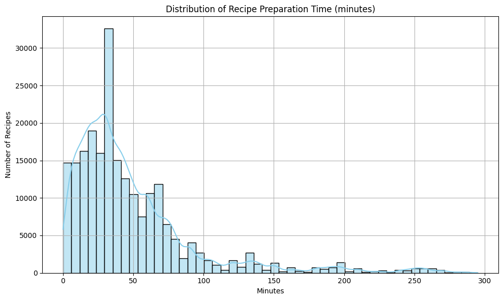
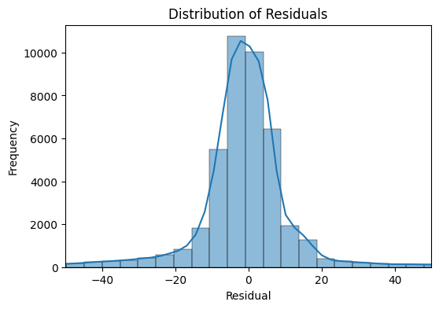
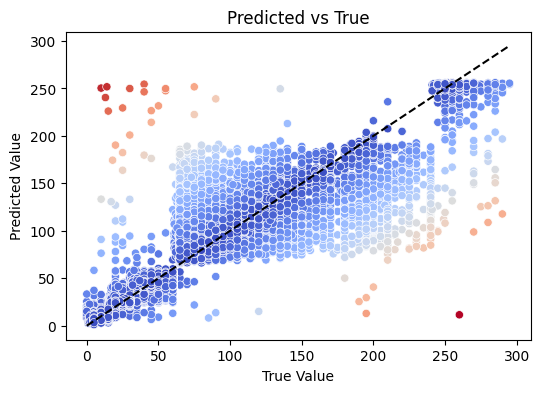
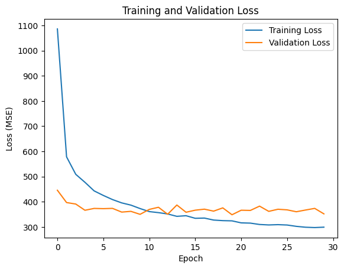

# Pre traitement et Choix de donnée

- statistiques descriptives: nombre de tokens par doc, classes, vue d'ensemble des jeux de données
- choix de traitement, impact ?

Pas de redondance
Clarté
Limites, difficulté, pistes

# Start of the report

# Dataset

## Description

Brief description of the dataset used for training and evaluation.

- **Source**: [RecipeNLG](https://recipenlg.cs.put.poznan.pl/)
- **Size**: 
   - 231 636 (total)
   - 221 457 (regression task)
- **Geographic coverage**: All around the world but mostly USA, Europe and Asia.

## Features

| Feature        | Description                                           | Type            | Example Values                             |
|----------------|-------------------------------------------------------|------------------|--------------------------------------------|
| name           | Name of the recipe                                    | String           | "Spaghetti Bolognese", "Chicken Curry"     |
| minutes        | Preparation and cooking time in minutes               | Integer          | 30, 45, 120                                 |
| tags           | List of tags describing the recipe                    | List of Strings  | ["dinner", "easy", "vegetarian"]           |
| nutrition      | Nutritional information per serving                   | List of Floats   | [500.0, 20.0, 30.0, 5.0, 10.0, 60.0]        |
| steps          | Step-by-step cooking instructions                     | List of Strings  | ["Boil water", "Add pasta", "Stir sauce"]  |
| n_steps        | Number of steps in the recipe                         | Integer          | 3, 5, 10                                    |
| description    | Detailed description of the recipe                    | String           | "A classic Italian pasta dish..."          |
| ingredients    | List of ingredients required for the recipe           | List of Strings  | ["spaghetti", "ground beef", "tomato"]     |
| n_ingredients  | Number of ingredients in the recipe                   | Integer          | 5, 8, 12                                    |

# Preprocessing

## Overview
This section explains all the preprocessing steps we applied to the dataset.

## Removing columns and rows

The first step in our preprocessing was to remove columns that were not relevant to our exploratory data analysis (EDA). For example, we excluded the  `contributor_id` column (which identifies the author of the recipe) and the `submitted` column (which indicates the submission date), as they did not serve our analytical objectives.

Next, we removed recipes with a total preparation time greater or equal than 5 hours (i.e., over 300 minutes), considering them outliers. This step eliminated approximately 10,000 recipes from the original dataset of around 231,000 entries.

## Lemmatizer & Stop-Word Removing
We then lemmatized the text in the name column using the nltk library, specifically the stopwords and wordnet packages. Additionally, we used a custom list of over 400 irrelevant or noisy words, such as names like "ashley" or "aston", to further clean the data. 

This helped non-informative recipe names (e.g., "leave you licking your fingers and think about it all day OH MY GOD ITS SO AMAZINGGGGG potatoes with chicken yummy yummy") into concise and meaningful titles like "potatoes with chicken".

## Columns Normalization

## Cleaning and Standardizing Instructions

We also performed preprocessing on the `steps_strings` column, which contains the step-by-step instructions for each recipe. This involved the following key tasks:

1. **Correcting Typos in Units**  
   We manually corrected common misspellings, such as `"minteus"` instead of `"minutes"`, to ensure consistency in unit recognition.

2. **Standardizing Units**  
   To maintain uniformity, we converted various units to standard formats—for example:  
   - milliliters (mL) → liters (L)  
   - inches → centimeters (cm)  
   - Fahrenheit → Celsius (°C)  

3. **Converting Imprecise Quantities**  
   Imprecise or range-based quantities were normalized to approximate average values. Examples include:  
   - `"1/2"` → `0.5`  
   - `"2-3"` or `"2 to 3"` → `2.5`  

4. **Stemming Words**  
   To further reduce variability and enhance text matching, we applied stemming to all words in the instructions. This helped standardize different forms of the same root word (e.g., `"chopped"`, `"chopping"`, `"chop"` → `"chop"`).

## Column Expanding

After the general preprocessing, we decided—following the recommendation from [RecipeNLG](https://recipenlg.cs.put.poznan.pl/)—to expand the `nutrition` column into separate features for better insight into the food's composition.

The `nutrition` column was originally a list of values. We split it into the following individual columns:

- `calories`
- `total_fat`
- `sugar`
- `sodium`
- `protein`
- `saturated_fat`
- `carbohydrates`

This allowed for more granular analysis and visualization of nutritional content across recipes.

# Recipe Time Prediction Models Benchmark

## Overview

This benchmark compares multiple regression models for predicting recipe preparation time based on various features. The goal is to identify the most accurate model for estimating how long a recipe will take to prepare.

## Target Variable

- **Preparation Time**: Total time in minutes to prepare the recipe (includes both active cooking and passive waiting time)
- **Distribution**: Brief description of the distribution of preparation times

## Methodology

### Data Preprocessing

- Feature engineering steps
- Handling of missing values
- Normalization/standardization approach
- Train/validation/test split: [e.g., 70%/15%/15%]

### Models Evaluated

1. **Linear Regression**
   - A fundamental statistical method used to model the relationship between one or more input features and a continuous target variable.
   - It assumes a linear relationship between the input variables and the output.
   - The model tries to find the best-fitting line (or hyperplane) by minimizing the sum of squared errors between the predicted and actual values.
   - It’s easy to implement, interpret, and serves as a baseline model in many machine learning tasks.

2. **Bayesian Ridge**

   - Bayesian Ridge Regression is a linear regression technique that incorporates Bayesian inference to estimate the model parameters.
   - It assumes that the coefficients of the linear model follow a Gaussian prior distribution.
   - Unlike ordinary linear regression, it adds regularization to prevent overfitting, similar to Ridge Regression.
   - The level of regularization is automatically determined from the data by estimating the distribution of model parameters.
   - It provides probabilistic predictions, meaning it can quantify the uncertainty in its outputs.

3. **Feedforward Neural Network**

   - A type of artificial neural network where connections between nodes do not form cycles.
   - Data flows in one direction: input → hidden layers → output.
   - Consists of:
      - **Input layer**: Receives the initial data.
      - **Hidden layer(s)**: Perform computations via weighted connections and activation functions.
      - **Output layer**: Produces the final prediction or classification.
   - Commonly used for supervised learning tasks like classification and regression.
   - Simpler architecture compared to recurrent or convolutional neural networks.

4. **Gated Recurrent Unit Neural Network**

   - **GRU** is a type of recurrent neural network that was developed to solve problems faced by traditional RNNs, such as the vanishing gradient problem.
   - **GRUs** are simpler and more efficient than **LSTMs** while often achieving comparable performance.
   - They use two gates:
      - **Update gate**: controls how much of the previous information to carry forward.
      - **Reset gate**: decides how much of the past information to forget.
   - GRUs help models retain long-term dependencies in sequential data like text.

5. **Transformer**
   - Deep learning architecture that rely entirely on attention mechanisms, removing the need for recurrence (as used in RNNs and LSTMs).
   - The key component is self-attention, which allows the model to weigh the importance of different words in a sentence, regardless of their position.
   - Transformers use positional encoding to retain information about the order of tokens in the input sequence.
   - They are highly parallelizable and scalable, making them faster to train on large datasets compared to sequential models.

### Evaluation Metrics

- Mean Absolute Error (MAE)
- Mean Squared Error (MSE)
- Root Mean Squared Error (RMSE)
- R² Score

## Results

### Performance Comparison

| Model              | MAE       | MSE         | RMSE      | R²     | Train Time (s) | Embedding Type |
|--------------------|----------|------------|----------|----------|----------------|---------------|
| Linear Regression | 15.1705   | 634.5855   | 25.1910  | 0.7006   | 10.93          | TF-IDF        |
| Bayesian Ridge    | 15.1901   | 635.0655   | 25.2005  | 0.7004   | 17.44          | TF-IDF        |
| Feedforward NN   |  9.3618   | 340.7969   | 18.4607  | 0.8392   | 253.49         | TF-IDF        |
| Gated Recurrent Unit | 9.7872   | 337.6653  | 18.3756  | 0.8406   | 3743.74      | TF-IDF      |
| Transformer       | | |  |    |          |         |
| Linear Regression | 23.6824   | 1374.7565  | 37.0777  | 0.3514   | 4.33           | Word2Vec      |
| Bayesian Ridge    | 23.6587   | 1374.4485  | 37.0736  | 0.3515   | 11.34          | Word2Vec      |
| Feedforward NN   | 20.0696   | 1174.3258  | 34.2684  | 0.4459   | 137.41         | Word2Vec      |

### Feature Importance Analysis

In progress for feedforward models.

### Residual Analysis

#### Distribution

We have plotted the residuals of the best-performing model (Gated Neural Network) to check for patterns. The residuals appear to be concentrated around zero, indicating that the model is performing well despite some outliers.

#### Comparaison with True Values

As you can see in the figure below, the model's predictions are generally close to the true values, with some exceptions. The model tends to underatimate the preparation time for recipes with very long preparation times, which is likely due to the limited amount of data available for these cases.

Some recipes with relatively short preparation times (less than 40 min) are overestimated, but most of the recipes in that timezone are well predicted.

### Learning Curves

You can see that the model is not overfitting, as the training and validation errors are close to each other. However, the validation error seems to oscillate at the end of the training, which could indicate that the model is not learning anymore and may start to overfit. Thus our early stopping criterion has been reached and the training has been stopped.

### ASK Maxim to retrain feedforward with (TF-IDF) with variyng and compare the results.

## Discussion

### Model Strengths and Weaknesses

| Model                      | Strengths                                                                 | Weaknesses                                                               |
|---------------------------|---------------------------------------------------------------------------|--------------------------------------------------------------------------|
| Linear Regression          | Simple, interpretable, fast to train                                      | Assumes linear relationships, sensitive to outliers                      |
| Random Forest              | Handles non-linear data well, robust to overfitting, works with missing data | Can be slow with large datasets, less interpretable                      |
| Bayesian Ridge             | Handles multicollinearity, provides uncertainty estimates                 | Assumes linearity, may be sensitive to prior selection                   |
| Feedforward Neural Network | Can model complex non-linear patterns                                     | Risk of overfitting, less interpretable             |
| Gated Recurrent Unit       | Suitable for sequential data, fewer parameters than LSTM          | Difficult to train, requires significant computational resources         |
| Transformer                | Handles long-range dependencies, parallelizable                          | Requires large datasets, complex architecture, computationally expensive |

From the result we have shown above, the most suitable model for this task is the Feedforward Neural Network, which indeed outperforms the other models in terms of MAE and R2 Score. The Gated Recurrent Unit and Transformer models also performed well, but they were significantly slower to train and required more computational resources/data.

### Analysis

- The most challengind part about this task is the processing of the text data. The recipes are often written in a non-standardized way, with various units and formats and some contains useless information that may mislead the model.
- The linear models (Linear Regression and Bayesian Ridge) also performed amazingly well, but they were not able to capture the non-linear relationships in the data as well as the neural networks.
- The Word2Vec embeddings did not perform as well as the TF-IDF embeddings. As the TF-IDF directly reflects the importance of words in the dataset, while Word2Vec focuses on semantic similarity and context. For regression tasks (time prediction in our case), the presence or absence of certain keywords (captured by TF-IDF) may be more predictive than semantic similarity.
### Recommendations

- Best overall model:
   - **Feedforward Neural Network**: it is the best trade-off between performance and training time as the GRU model is very slow to train and requires a lot of computational resources but enhance the performance by a very small margin.
- Best model for fast recipes: [model name]
- Best model for long recipes: [model name]

## Conclusion

In this benchmark, we evaluated multiple regression models for predicting recipe preparation time. The Feedforward Neural Network emerged as the best-performing model, achieving the lowest MAE and RMSE while maintaining a reasonable training time. The Gated Recurrent Unit model also performed well but was significantly slower to train and did not provide a substantial performance boost.

The results indicate that while linear models can provide a good baseline, more complex models like neural networks are better suited for capturing the intricacies of recipe preparation times.